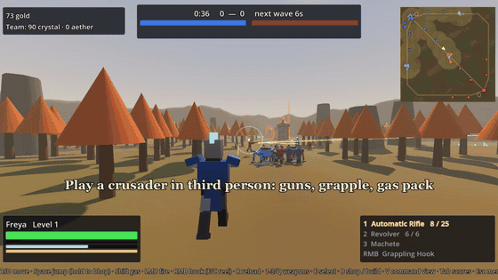

# Crusader Colonists

A 6v6 third-person hero shooter with MOBA lanes and RTS bases, built in Godot 4. It combines [Crusaders](https://github.com/chillinturt/Crusaders) and [Colonist](https://github.com/chillinturt/Colonist): fight in the lane as a crusader, or press V to run your team's base from a top-down Command View. (The in-game title screen calls it *Crusader Clonists*.)

**[Watch the full trailer (MP4)](media/trailer.mp4)**

## How a match works

- **Two teams of six:** you and five bots against six bots, on a generated three-lane map.
- **Heroes:** third-person crusaders with bunny hopping, a grappling hook and a gas pack. Earn gold and levels, shop at your fountain, and respawn there when you die.
- **Bases:** peasants mine crystal and aether into the team's bank, and anyone on the team can spend it from the Command View. An AI commander runs the enemy base and, if you like, helps run yours.
- **Lanes:** each keep sends a minion wave down every lane every 30 seconds. Your base makes the waves stronger: Barracks add units, a Forge adds siege golems, an Aerie adds harpies and a Sanctum adds titans.
- **Winning:** two towers guard each lane. The inner tower is shielded until the outer one falls, and the keep is shielded until a whole lane is broken. Destroy the enemy keep to win.

## Weapons

Choose one per slot before the match:

| Primary | Secondary | Melee |
| --- | --- | --- |
| Automatic Rifle | Revolver | Machete |
| Shotgun | Grenades | Battle Axe |
| Sniper | | Sledgehammer |
| Rocket Launcher | | |

## Controls

**As a hero**

| Input | Action |
| --- | --- |
| W A S D | Move |
| Space | Jump (hold to bunny hop) |
| Left mouse | Fire |
| Right mouse | Grappling hook |
| F / C | Reel in / reel out |
| Shift | Gas pack |
| R | Reload |
| 1-3, mouse wheel, Q | Switch weapon / last weapon |
| B | Shop at your fountain |
| E | Select your unit under the crosshair (hold to add more) |
| Tab | Scoreboard |
| V | Command View |

With peasants selected, B opens their build menu: press a structure's key, aim, then left-click to place it.

**In the Command View**

| Input | Action |
| --- | --- |
| Left-click / drag | Select |
| Right-click | Move, attack or gather |
| A / S / H / P | Attack-move / stop / hold / patrol |
| B | Build (with a peasant selected) |
| Shift | Queue orders |
| Ctrl + 1-0 | Set control groups |
| Arrow keys, screen edges, middle-drag | Pan |
| Mouse wheel | Zoom |

## Running the game

1. Install [Godot 4.7](https://godotengine.org/download/).
2. In the Project Manager, import this folder's `project.godot`.
3. Press **F5** to play.

To watch a bots-only match, run `godot --path . -- --autotest`. It plays at 3x speed.

Developed and tested on Windows with Godot 4.7.2 (.NET build). There's no C# code, so the standard build should also work, but that hasn't been tested. All the art is generated from code and simple meshes, and the game currently has no audio.

## About the trailer

The trailer is silent, recorded in the engine with Godot's Movie Maker mode. It shows the game's own bots-only match rather than a human player. The map was fixed to the autumn woods, the fog of war's darkening was turned off on the overhead shots, and slow stretches were fast-forwarded and cut.

## License

No license has been chosen yet, so all rights are reserved.
